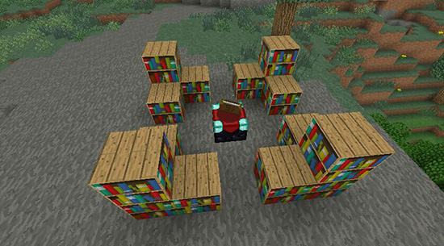
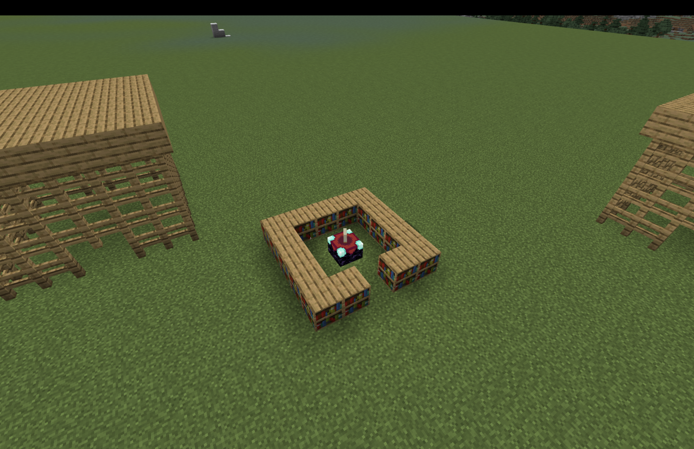

# Agent 蓋附魔台

[返回麥塊程式首頁](../../README.md)

讓 Agent 沿四邊放置書櫃，最後在中央放下附魔台。

- 程式概念：迴圈、方向
- 難度：中階
- 啟動指令：在聊天室輸入 `1`
- [教學影片](https://www.youtube.com/watch?v=UpeoVeZAGRM)

## 準備

1. 第 1 格放書櫃，第 2 格放附魔台。
2. 將 Agent 放在建築範圍的一角，正下方保持可放置方塊。
3. 預留中央空間，避免玩家或其他方塊擋住 Agent。

## MakeCode Python

```python
def on_on_chat():
    agent.move(UP, 1)
    for index in range(4):
        agent.move(FORWARD, 1)
        agent.set_slot(1)
        agent.place(DOWN)
    agent.turn(RIGHT_TURN)
    for index2 in range(4):
        agent.move(FORWARD, 1)
        agent.set_slot(1)
        agent.place(DOWN)
    agent.turn(RIGHT_TURN)
    for index3 in range(4):
        agent.move(FORWARD, 1)
        agent.set_slot(1)
        agent.place(DOWN)
    agent.turn(RIGHT_TURN)
    for index4 in range(4):
        agent.move(FORWARD, 1)
        agent.set_slot(1)
        agent.place(DOWN)
    agent.move(RIGHT, 2)
    agent.destroy(DOWN)
    agent.move(FORWARD, 2)
    agent.set_slot(2)
    agent.place(DOWN)
player.on_chat("1", on_on_chat)
```

## 執行結果





## 測試與活動

- 開啟附魔台，確認書櫃能提升附魔等級。
- 討論四段相似程式能否再整理成自訂函數。

> 公開版已把原資料中的重複巢狀迴圈整理為四段清楚的邊線程式；尚未在本次發布流程中重新實機驗證。
