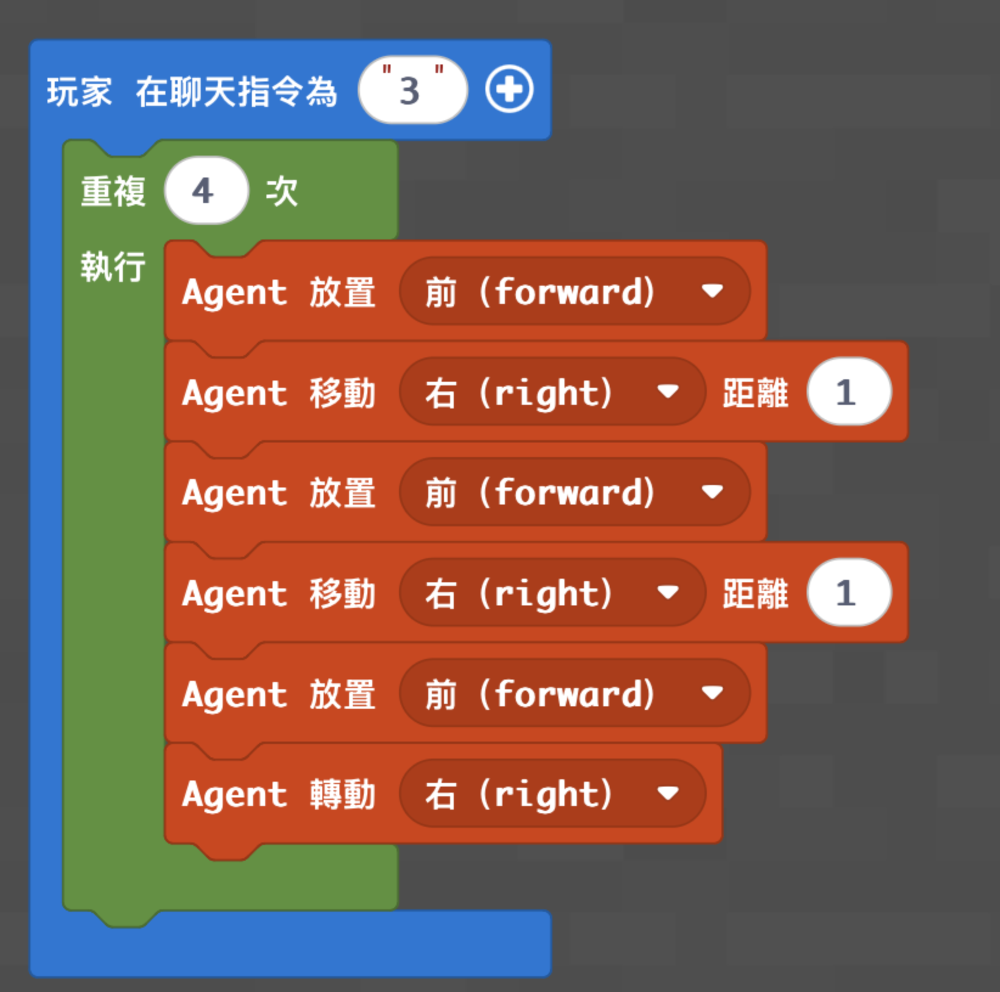
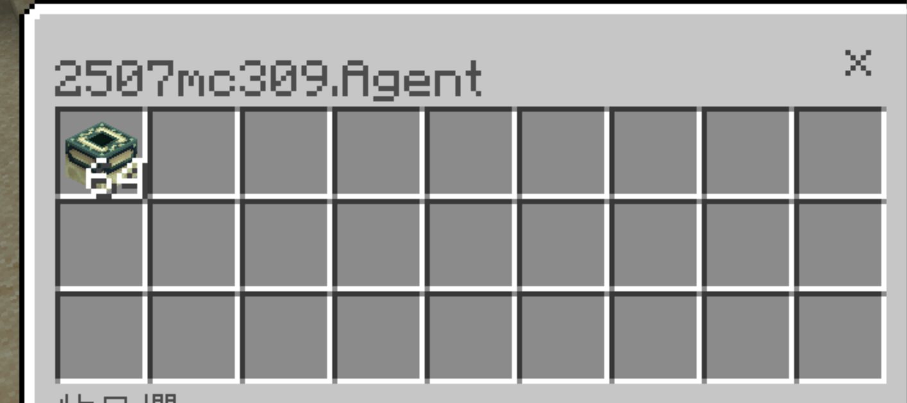

# Agent 蓋終界門

[返回程式資料庫](../README.md) · [麥塊程式首頁](../../README.md)

讓 Agent 轉向四次，完成終界傳送門的方形框架。

- 程式概念：迴圈、方向
- 難度：中階
- 啟動指令：在聊天室輸入 `3`
- [教學影片](https://www.youtube.com/watch?v=QtqZxpNwxWE)

## 準備

1. 將終界傳送門框放入 Agent 目前選取的物品欄。
2. 將 Agent 放在預定框架旁，確認四周至少有 5 × 5 的平坦空間。
3. 框架完成後，由玩家手動放入終界之眼。

## MakeCode Python

```python
def on_on_chat():
    for index in range(4):
        agent.place(FORWARD)
        agent.move(RIGHT, 1)
        agent.place(FORWARD)
        agent.move(RIGHT, 1)
        agent.place(FORWARD)
        agent.turn(RIGHT_TURN)
player.on_chat("3", on_on_chat)
```

## 執行結果





## 測試與活動

- 確認 12 個門框方向一致，再放入終界之眼。
- 請學生解釋為什麼外層迴圈剛好執行四次。

> 這份程式依既有教學資料整理，尚未在本次發布流程中重新實機驗證。
