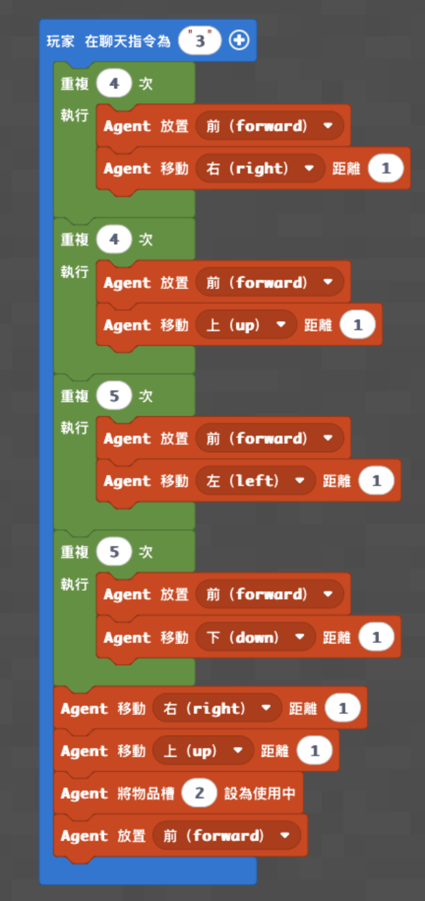
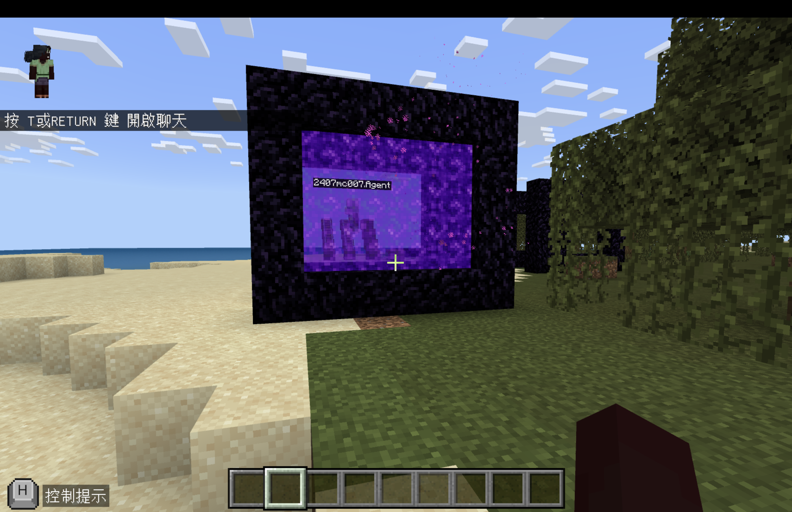

# Agent 蓋地獄門

[返回麥塊程式首頁](../../README.md)

用 Agent 依序完成地獄門框，再自動點火。

- 程式概念：迴圈、方向
- 難度：中階
- 啟動指令：在聊天室輸入 `1`
- [教學影片](https://www.youtube.com/watch?v=EVcu0TxWyJk)

## 準備

1. Agent 物品欄第 1 格放黑曜石，第 2 格放打火石。
2. 將 Agent 放在預定門框左下角，面向門框要生成的方向。
3. 門框前方保留足夠空間。

## MakeCode Python

```python
def on_on_chat():
    agent.set_slot(1)
    for index in range(4):
        agent.place(FORWARD)
        agent.move(RIGHT, 1)
    for index2 in range(4):
        agent.place(FORWARD)
        agent.move(UP, 1)
    for index3 in range(4):
        agent.place(FORWARD)
        agent.move(LEFT, 1)
    for index4 in range(4):
        agent.place(FORWARD)
        agent.move(DOWN, 1)
    agent.set_slot(2)
    agent.move(RIGHT, 1)
    agent.move(UP, 1)
    agent.place(FORWARD)
player.on_chat("1", on_on_chat)
```

## 執行結果





## 測試與活動

- 確認門框完整、火焰成功點燃，玩家可以進入地獄。
- 改變 Agent 起點與朝向，觀察方向指令如何影響建築位置。

> 這份程式依既有教學資料整理，尚未在本次發布流程中重新實機驗證。
