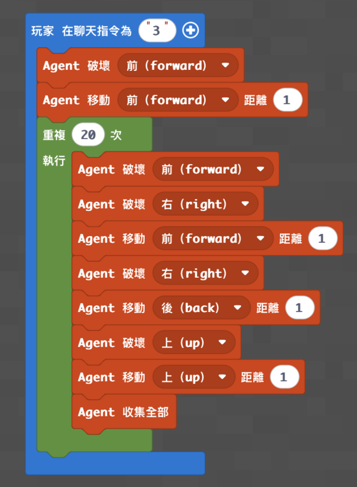

# 砍超大樹機器人

[返回程式資料庫](../README.md) · [麥塊程式首頁](../../README.md)

讓 Agent 一層一層處理粗樹幹，適合挑戰大型樹木。

- 程式概念：迴圈、方向
- 難度：中階
- 啟動指令：在聊天室輸入 `3`
- [教學影片](https://www.youtube.com/watch?v=Eev5VJZwym0)

## 準備

1. 將 Agent 放在粗樹幹前，面向最底層原木。
2. 清除樹幹周圍會阻擋 Agent 移動的方塊。
3. 程式預設最多處理 20 層，可依樹高調整。

## MakeCode Python

```python
def on_on_chat():
    agent.destroy(FORWARD)
    agent.move(FORWARD, 1)
    for index in range(20):
        agent.destroy(FORWARD)
        agent.destroy(RIGHT)
        agent.move(FORWARD, 1)
        agent.destroy(RIGHT)
        agent.move(BACK, 1)
        agent.destroy(UP)
        agent.move(UP, 1)
        agent.collect_all()
player.on_chat("3", on_on_chat)
```

## 執行結果



## 測試與活動

- 觀察每層的移動路線，畫出 Agent 的俯視軌跡。
- 將 20 改成實際樹高，避免 Agent 繼續向空中移動。
- 比較一般砍樹與超大樹程式的差異。

> 這份程式依既有教學資料整理，尚未在本次發布流程中重新實機驗證。
