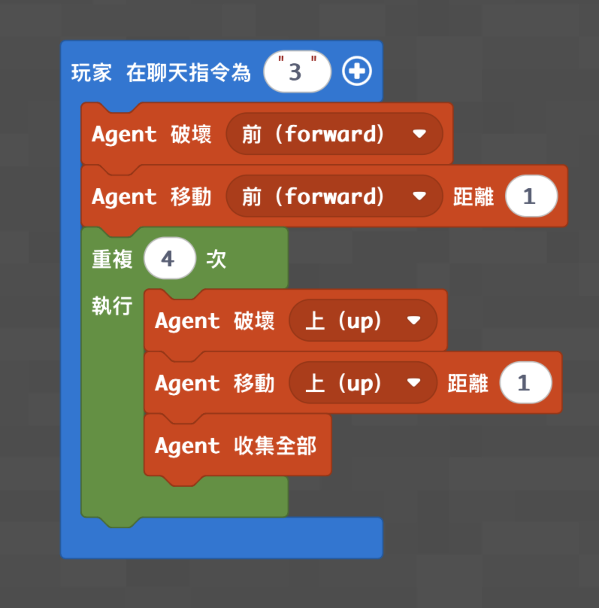

# 砍樹機器人

[返回程式資料庫](../README.md) · [麥塊程式首頁](../../README.md)

讓 Agent 從樹根一路向上砍伐並收集木材。

- 程式概念：迴圈
- 難度：初階
- 啟動指令：在聊天室輸入 `3`

## 準備

1. 將 Agent 放在樹幹前，正面緊貼最底層原木。
2. 確認樹幹上方沒有會阻擋 Agent 的非木頭方塊。

## MakeCode Python

```python
def on_on_chat():
    agent.destroy(FORWARD)
    agent.move(FORWARD, 1)
    for index in range(4):
        agent.destroy(UP)
        agent.move(UP, 1)
        agent.collect_all()
player.on_chat("3", on_on_chat)
```

## 執行結果



## 測試與活動

- 執行後確認樹幹被清除，木材進入 Agent 物品欄。
- 改變迴圈次數，配合不同高度的樹。
- 比賽在限定時間內讓 Agent 收集最多木材。

> 這份程式依既有教學資料整理，尚未在本次發布流程中重新實機驗證。
